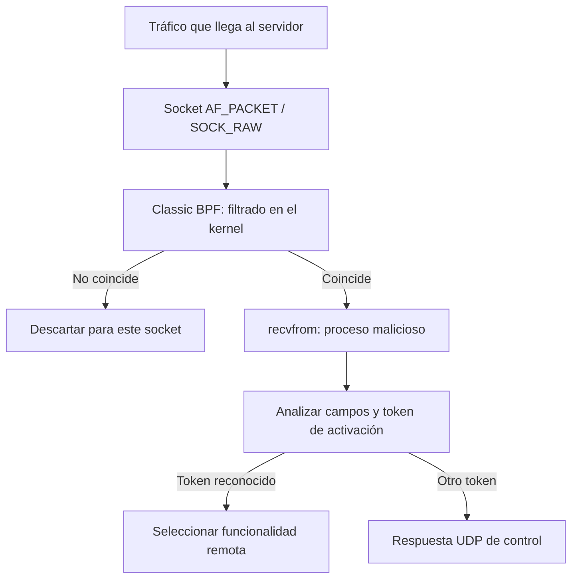

# ShadowMonarch 🕵️‍♂️

### Ingeniería inversa de una backdoor Linux con activación mediante Berkeley Packet Filter (BPF)

**Write-up técnico | Linux x86-64 | Análisis estático + análisis dinámico controlado | MITRE ATT&CK: T1205.002**

> **Contexto:** este documento analiza la muestra de laboratorio `shadow_monarch`, facilitada en un reto de reversing. El escenario plantea actividad sospechosa en un servidor crítico de una operadora de telecomunicaciones del sudeste asiático que no había generado alertas del EDR. Esa descripción es el **contexto del ejercicio**, no una atribución independiente a una organización o campaña real.
>
> **Seguridad:** la muestra se trató como malware real. La ejecución dinámica se realizó exclusivamente en una VM REMnux con red aislada. Este repositorio documenta el análisis; **no incluye el ejecutable malicioso ni herramientas para activar su shell**.

## Índice

1. [¿Qué es una backdoor pasiva y por qué es peligrosa?](#1-qué-es-una-backdoor-pasiva-y-por-qué-es-peligrosa)
2. [BPF: el mecanismo que cambia las reglas del juego](#2-bpf-el-mecanismo-que-cambia-las-reglas-del-juego)
3. [Resumen de ShadowMonarch](#3-resumen-de-shadowmonarch)
4. [Metodología de análisis](#4-metodología-de-análisis)
5. [Análisis estático: primeras pistas](#5-análisis-estático-primeras-pistas)
6. [Análisis dinámico: lo que realmente hizo](#6-análisis-dinámico-lo-que-realmente-hizo)
7. [Reconstrucción del filtro BPF](#7-reconstrucción-del-filtro-bpf)
8. [Protocolo de activación y funciones](#8-protocolo-de-activación-y-funciones)
9. [Cifrado RC4 y handshake](#9-cifrado-rc4-y-handshake)
10. [Ocultación, IOC y detección](#10-ocultación-ioc-y-detección)
11. [MITRE ATT&CK](#11-mitre-attck)
12. [Conclusiones y límites](#12-conclusiones-y-límites)
13. [Referencias](#13-referencias)

---

## 1. ¿Qué es una backdoor pasiva y por qué es peligrosa?

Una **backdoor** es un mecanismo de acceso oculto que permite a un tercero interactuar con un sistema saltándose sus vías habituales de administración o autenticación. Una backdoor puede mantener una conexión permanente con su servidor de mando y control (*C2*), pero eso genera tráfico que un SOC puede estudiar.

Una **backdoor pasiva** sigue una estrategia distinta: permanece a la espera de una señal muy concreta. Hasta que llega, puede no abrir ningún puerto TCP convencional ni realizar conexiones salientes. El atacante envía un paquete especial —a veces denominado **magic packet**— y solo entonces se activa una función del implante.

| Backdoor convencional | Backdoor pasiva de este tipo |
|---|---|
| Puede mantener una conexión periódica con C2 | Puede permanecer esperando sin contactar con C2 |
| Puede abrir un puerto TCP visible | Puede recibir paquetes usando un socket de captura de bajo nivel |
| El tráfico periódico genera señales de detección | La ausencia de tráfico reduce ciertas señales de detección |
| El escaneo de puertos puede revelar un servicio | Un escaneo de puertos no tiene por qué revelar el implante |

Esto **no la convierte en invisible al EDR**. La creación de sockets especiales, el uso de filtros BPF, los cambios en procesos y el acceso a shells siguen dejando huellas. La dificultad está en correlacionarlas.

La familia **BPFDoor** es un ejemplo conocido de esta arquitectura. ShadowMonarch presenta un diseño **compatible con las técnicas documentadas para BPFDoor**, pero el análisis de esta muestra **no permite atribuirla de forma concluyente a una variante pública ni a un grupo de amenazas**.

## 2. BPF: el mecanismo que cambia las reglas del juego

**Berkeley Packet Filter (BPF)** permite aplicar pequeños programas de filtrado sobre los paquetes de red. En nuestro caso se trata de **classic BPF (cBPF)** asociado a un socket: **no estamos afirmando que el malware sea un rootkit eBPF ni que cargue un módulo del kernel**.

De forma simplificada, el implante utiliza:

```c
socket(AF_PACKET, SOCK_RAW, htons(ETH_P_IP));
setsockopt(fd, SOL_SOCKET, SO_ATTACH_FILTER, &filter, sizeof(filter));
recvfrom(fd, ...);
```

El socket recibe tráfico a bajo nivel. El filtro decide qué paquetes pasan hasta el proceso. La aplicación examina los paquetes seleccionados y, si su contenido supera las comprobaciones adicionales, ejecuta la funcionalidad correspondiente.



**¿Por qué es evasivo?** Porque el implante puede observar tráfico sin dejar un servicio en estado `LISTEN` para la activación inicial. Además, el filtro reduce el número de paquetes que la aplicación tiene que procesar. La inspección a nivel de socket es distinta de abrir un puerto TCP convencional.

Importante: el filtro BPF **no ejecuta comandos por sí solo**; únicamente decide qué tráfico recibe el proceso. La comprobación del token y la ejecución posterior ocurren en espacio de usuario.

---

## 3. Resumen de ShadowMonarch

| Propiedad | Resultado |
|---|---|
| Archivo de la muestra | `shadow_monarch` |
| SHA-256 | `41de260cb5518df31ad437f4c0bf0fb2fea848e7648b1911658275da00f2fd16` |
| Tamaño | 30.856 bytes |
| Formato | ELF de 64 bits, x86-64, PIE, dinámico, *stripped* |
| Compilador identificado | GCC 11.4.0 (Ubuntu) |
| Requisitos observados | Comprobación de UID 0 (root) |
| Captura | `AF_PACKET` + `SOCK_RAW` |
| Filtro | 30 instrucciones cBPF, instalado con `SO_ATTACH_FILTER` |
| Protocolos de activación | TCP, UDP e ICMP sobre IPv4 |
| Cifrado del canal de shell | RC4 |
| Funcionalidad | Shell inversa, shell en escucha con redirección y respuesta de control |

**El hallazgo principal:** hemos confirmado **dinámicamente** que el proceso se copia a `/dev/shm`, elimina el archivo temporal e instala con éxito su filtro BPF. Las funciones de shell y el protocolo se han **reconstruido estáticamente**; no se observó una sesión C2 real.

## 4. Metodología de análisis

Combinamos dos enfoques:

- **Estático:** lectura de metadatos ELF, símbolos importados, cadenas, datos y código ensamblador, **sin ejecutar el programa**.
- **Dinámico:** ejecución controlada en REMnux aislado, con `strace` y `tcpdump` preparados antes de iniciar la muestra.

Herramientas utilizadas o equivalentes:

| Herramienta | Objetivo |
|---|---|
| `file`, `sha256sum` | Identificación e integridad |
| `readelf` | Formato ELF, símbolos dinámicos y secciones |
| `strings` | Cadenas y artefactos embebidos |
| `objdump` | Desensamblado y referencias cruzadas manuales |
| `strace` | Procesos, archivos, sockets y llamadas al sistema |
| `tcpdump` / Wireshark | Observación de tráfico de red |
| `ss` | Inspección de sockets después de la ejecución |

La regla que seguimos durante todo el trabajo fue **formular una hipótesis con el código y contrastarla, cuando fuese posible, con el comportamiento real**.

---

## 5. Análisis estático: primeras pistas

### 5.1. Identificar el ELF

```bash
file shadow_monarch
sha256sum shadow_monarch
readelf -h shadow_monarch
```

El binario es un ELF Linux x86-64 enlazado dinámicamente y con los símbolos de depuración eliminados (*stripped*). Eso complica el reversing porque no aparecen nombres descriptivos para las funciones internas.

### 5.2. Revisar funciones importadas

```bash
readelf -Ws shadow_monarch
objdump -d -M intel shadow_monarch > shadow_monarch.asm
```

Entre las funciones relevantes aparecen `socket`, `setsockopt`, `recvfrom`, `connect`, `bind`, `listen`, `accept`, `execve`, `fork`, `prctl`, `getuid` y `utimes`. Individualmente pueden ser legítimas; juntas nos orientaron hacia **captura de red, control remoto, creación de procesos y ocultación**.

### 5.3. Comprobar la exigencia de root

El ensamblador contiene una llamada a `getuid()` y una comparación con cero:

```asm
call getuid@plt
test eax, eax
je   continuar
; si UID != 0, abandonar esta ejecución
```

Lo contrastamos ejecutándolo como el usuario normal de REMnux:

```text
getuid() = 1000
+++ exited with 0 +++
```

**Interpretación:** con UID 1000 abandona la ruta principal. Al ejecutarlo como root en la VM aislada sí alcanzó el código de instalación del filtro. Esta comprobación explica por qué una primera ejecución sin privilegios parecía no hacer nada.

### 5.4. ¿Por qué `strings` no revela todo?

`strings -a shadow_monarch` permite ver `/dev/shm`, rutas de `systemd`, `/bin/sh`, `HISTFILE`, `MYSQL_HISTFILE` y `3458`. Sin embargo, parte de las cadenas de control se construyen mediante valores inmediatos en instrucciones ensamblador, por lo que **no aparecen completas como texto continuo**.

Este detalle enseña una lección útil: **que una cadena no aparezca en `strings` no significa que no exista en la lógica del programa**.

---

## 6. Análisis dinámico: lo que realmente hizo

Se ejecutó en una **VM REMnux con red aislada**, usando `strace` y una captura de `tcpdump` previamente iniciada. Los siguientes fragmentos proceden de esas trazas del laboratorio.

### 6.1. Copia a `/dev/shm` y eliminación

Se observó esta cadena de acciones:

```text
/bin/rm -f /dev/shm/.systemd-runtime
/bin/cp ./shadow_monarch /dev/shm/.systemd-runtime
/bin/chmod 755 /dev/shm/.systemd-runtime
/dev/shm/.systemd-runtime --init
/bin/rm -f /dev/shm/.systemd-runtime
```

`/dev/shm` suele estar respaldado por memoria y es temporal. La muestra se ejecuta desde una copia con nombre aparentemente relacionado con `systemd`, y después elimina ese archivo. **Borrar el archivo no implica necesariamente que un proceso ya lanzado deje de existir.**

### 6.2. Timestomping

```text
utimensat(..., "/dev/shm/.systemd-runtime",
  [2023-11-10 00:00:00 UTC, 2023-11-10 00:00:00 UTC], 0) = 0
```

Cambió las fechas de acceso y modificación a **10 de noviembre de 2023**. La finalidad probable es hacer que el artefacto parezca más antiguo que su instalación real.

### 6.3. Control de instancia

```text
access("/var/run/systemd-private.pid", R_OK) = -1 ENOENT
openat(AT_FDCWD, "/var/run/systemd-private.pid", O_WRONLY|O_CREAT, 0644) = 3
```

El malware comprueba y crea `/var/run/systemd-private.pid`, utilizado como **marcador para evitar múltiples instancias**. La traza demuestra su creación, **pero no muestra que se escribiera un PID en el archivo**.

### 6.4. La prueba decisiva: instalación de BPF

```text
14:56:12.576183 socket(AF_PACKET, SOCK_RAW, htons(ETH_P_IP)) = 3
14:56:12.576404 setsockopt(3, SOL_SOCKET, SO_ATTACH_FILTER,
                    {len=30, filter=...}, 16) = 0
14:56:12.576543 recvfrom(3,
```

Aquí está la evidencia dinámica más importante:

- `AF_PACKET` + `SOCK_RAW`: apertura de un socket de captura de bajo nivel.
- `SO_ATTACH_FILTER`: adjunta un filtro BPF.
- `{len=30}`: el filtro contiene **30 instrucciones**.
- `= 0`: el kernel acepta la operación.
- `recvfrom()`: el proceso entra en la ruta de recepción de paquetes.

El fragmento de traza termina con la llamada `recvfrom()` sin mostrar su retorno. **No demuestra que llegase un paquete de activación**.

### 6.5. ¿Qué apareció en Wireshark?

La captura resultante pesaba **116 bytes** y contenía **un único paquete**, una solicitud ICMPv6 *Router Solicitation* generada por el entorno de laboratorio.

**No había tráfico C2 ni magic packets en el PCAP.** Esto es coherente con una backdoor pasiva: la muestra puede permanecer a la espera sin iniciar una comunicación saliente. No obstante, la ausencia de tráfico **no demuestra por sí sola** que el malware siguiera activo durante toda la captura.

---

## 7. Reconstrucción del filtro BPF

El análisis del bytecode cBPF permitió interpretar sus comprobaciones principales:

| Comprobación | Comportamiento |
|---|---|
| EtherType | Acepta solo tramas IPv4 (`0x0800`) |
| Protocolo | Contempla UDP (`17`), ICMP (`1`) y TCP (`6`) |
| Fragmentación | Rechaza fragmentos con desplazamiento IPv4 distinto de cero (`0x1fff`) |
| UDP | Busca `0x8337` al principio del payload UDP |
| ICMP | Busca `0x8337` en los datos y exige Echo Request (tipo 8) |
| TCP | Calcula el comienzo del payload a partir de la longitud de la cabecera TCP y busca `0x4141` |
| Resultado | `RET 0xffff` para pasar el paquete; `RET 0` para descartarlo |

**Firmas de esta muestra:**

```text
TCP       41 41   (0x4141)
UDP       83 37   (0x8337)
ICMP      83 37   (0x8337)
```

Estas firmas **son específicas de `shadow_monarch`**. No deben confundirse con valores de otras variantes documentadas de BPFDoor. Una firma aislada tampoco basta para declarar que existe una infección: hay que correlacionarla con el proceso y sus acciones.

Un matiz técnico interesante: el filtro BPF calcula la longitud de la cabecera IPv4, mientras que algunas rutas del parser posterior presuponen una cabecera IPv4 de 20 bytes. Los paquetes con opciones IPv4 pueden no procesarse como se espera.

---

## 8. Protocolo de activación y funciones

Tras superar el filtro, el malware interpreta el payload como una estructura que contiene firma, dirección IPv4, puerto y cadena de control.

### 8.1. Estructura reconstruida

| Offset desde el inicio del payload | Longitud | Campo |
|---:|---:|---|
| `+0` | 2 bytes | Firma del protocolo correspondiente |
| `+2` | 2 bytes | Campo cuyo uso no quedó determinado en el parser analizado |
| `+4` | 4 bytes | Dirección IPv4 de destino o respuesta |
| `+8` | 2 bytes | Puerto en orden de red |
| `+10` | Variable | Cadena terminada en NUL para seleccionar la función |

El valor IPv4 `0xffffffff` indica que debe utilizarse la **IP origen del paquete** en lugar de una dirección embebida. En consecuencia, **no se identificó una IP C2 estática** en esta muestra.

La comparación de los tokens se realiza mediante `memcmp()` sobre la longitud del token conocido: en la ruta analizada funciona como una **comparación de prefijo**, no como una prueba estricta de igualdad completa de cadenas.

### 8.2. Ramas de comportamiento

| Cadena de control | Funcionalidad identificada estáticamente |
|---|---|
| `ph4nt0m_g4t3` | Abre una **conexión TCP inversa** al destino indicado y prepara una shell remota con comunicación RC4 |
| `r3d_m3nsh3n` | Prepara una **bind shell** y utiliza reglas temporales de `iptables` para redirigir conexiones |
| Otra cadena | Envía una respuesta UDP de un byte: ASCII `1` (`0x31`) |

La rama de bind shell recorre un rango de **puertos locales 31337–32336**. La redirección utiliza la cadena **`PREROUTING` de la tabla `nat`**; el código también contempla reglas de aceptación en `INPUT`.

**Nivel de evidencia:** estas ramas se dedujeron mediante ingeniería inversa del binario. No se activaron shells durante la prueba dinámica; por tanto, no afirmamos haber observado conexiones remotas efectivas ni cambios de `iptables` asociados a una activación real.

## 9. Cifrado RC4 y handshake

La muestra contiene una implementación reconocible de **RC4**, algoritmo de cifrado de flujo cuyos dos componentes principales son:

- **KSA (*Key Scheduling Algorithm*):** inicializa y mezcla un estado de 256 posiciones a partir de la clave.
- **PRGA (*Pseudo-Random Generation Algorithm*):** genera bytes de flujo que se combinan con los datos utilizando XOR.

El código reconstruido mantiene estados separados para cifrar datos salientes y descifrar datos entrantes en la sesión. La cadena usada para activar la funcionalidad también participa en la inicialización de ese canal.

Antes de comenzar la comunicación cifrada aparece la secuencia ASCII de cuatro caracteres:

```text
3458
```

La cadena se encuentra en los datos del ELF y se referencia desde la lógica de la shell. **RC4 está obsoleto para diseños criptográficos modernos**, pero aquí interesa identificar su uso como mecanismo de ocultación de una comunicación maliciosa, no valorar su seguridad como producto.

---

## 10. Ocultación, IOC y detección

### 10.1. Técnicas de ocultación

- **Ejecución temporal:** copia a `/dev/shm/.systemd-runtime` seguida de eliminación.
- **Control de instancia:** `/var/run/systemd-private.pid`.
- **Timestomping:** fechas fijadas a `2023-11-10 00:00:00 UTC`.
- **Masquerading:** lista de **10 identidades** que imitan procesos habituales del sistema.
- **Historial de shell:** configuración de `HISTFILE=/dev/null` y `MYSQL_HISTFILE=/dev/null`.
- **Escucha pasiva:** socket `AF_PACKET` con cBPF, sin necesidad de un puerto TCP de activación en `LISTEN`.

Las diez identidades encontradas en el ELF son:

```text
/usr/lib/systemd/systemd-journald
/usr/lib/systemd/systemd-udevd
/usr/lib/systemd/systemd-logind
/usr/lib/systemd/systemd-resolved
/usr/lib/systemd/systemd-timesyncd
/usr/sbin/rsyslogd -n
/usr/sbin/cron -f
/usr/sbin/sshd -D
/usr/lib/polkit-1/polkitd --no-debug
/usr/sbin/NetworkManager --no-daemon
```

Son nombres utilizados como **camuflaje potencial**; que un proceso legítimo tenga uno de estos nombres no significa que esté comprometido.

### 10.2. Indicadores específicos de la muestra

| Tipo | Indicador | Evidencia |
|---|---|---|
| SHA-256 | `41de260cb5518df31ad437f4c0bf0fb2fea848e7648b1911658275da00f2fd16` | Hash calculado del ELF |
| Ruta temporal | `/dev/shm/.systemd-runtime` | Traza de copia, ejecución y borrado |
| Marcador de instancia | `/var/run/systemd-private.pid` | Traza de comprobación y creación |
| Firma TCP | `41 41` | Filtro cBPF reconstruido |
| Firma UDP/ICMP | `83 37` | Filtro cBPF reconstruido |
| Handshake | `3458` | Cadena y referencia en el ELF |
| Rango de bind shell | `31337–32336` | Código de la rama correspondiente |
| Cifrado | RC4 | Rutinas KSA/PRGA reconstruidas |
| Fecha alterada | `2023-11-10 00:00:00 UTC` | `utimensat()` observado |

**No se identificaron direcciones IP, dominios o infraestructura del atacante específicos**. Las direcciones usadas para conexiones pueden suministrarse dentro del mensaje de activación.

### 10.3. Qué buscaría en un SOC

Para un equipo de defensa, los indicadores más útiles no son necesariamente las cadenas mágicas por separado, sino la **secuencia de comportamientos**:

1. Binario inesperado ejecutándose con privilegios elevados o desde `/dev/shm`.
2. Proceso con identidad similar a un servicio de `systemd`, pero ruta ejecutable, árbol de procesos o descriptores de archivos anómalos.
3. Creación de socket `AF_PACKET` seguida de `SO_ATTACH_FILTER`.
4. Tráfico entrante inusual seguido de `connect()`, ejecución de `/bin/sh` o modificación de `iptables`.
5. Archivos temporales eliminados tras su ejecución y fechas alteradas artificialmente.

Comprobaciones útiles **en un sistema bajo investigación**:

```bash
# Ver sockets de tipo PACKET y procesos asociados (si son visibles)
sudo ss -0ap

# Buscar rutas relacionadas con esta muestra
sudo ls -la /dev/shm/
sudo ls -l /var/run/systemd-private.pid

# Examinar, sin ejecutar, un binario sospechoso
file /ruta/al/archivo
sha256sum /ruta/al/archivo
```

Estas comprobaciones no garantizan detección: un implante puede eliminar sus archivos, cambiar su identidad o haber terminado. La telemetría de llamadas al sistema y la correlación entre procesos y red son especialmente valiosas.

---

## 11. MITRE ATT&CK

| Técnica | ID | Relación con la muestra |
|---|---|---|
| Traffic Signaling: Socket Filters | [T1205.002](https://attack.mitre.org/techniques/T1205/002/) | Activación mediante socket y filtro cBPF |
| Masquerading | [T1036](https://attack.mitre.org/techniques/T1036/) | Identidades de procesos que imitan servicios legítimos |
| Indicator Removal: Timestomp | [T1070.006](https://attack.mitre.org/techniques/T1070/006/) | Modificación de las fechas del archivo temporal |
| Indicator Removal: File Deletion | [T1070.004](https://attack.mitre.org/techniques/T1070/004/) | Borrado de la copia temporal del ejecutable |
| Command and Scripting Interpreter: Unix Shell | [T1059.004](https://attack.mitre.org/techniques/T1059/004/) | Funcionalidad de shell identificada estáticamente |
| Encrypted Channel: Symmetric Cryptography | [T1573.001](https://attack.mitre.org/techniques/T1573/001/) | Canal RC4 identificado estáticamente |

La técnica más característica del caso es **T1205.002 – Socket Filters**. Los mapeos de shell y cifrado reflejan **capacidades del binario** y no sesiones C2 observadas durante la prueba.

## 12. Conclusiones y límites

**ShadowMonarch es una backdoor Linux de activación pasiva cuyo diseño encaja con el funcionamiento general de BPFDoor.** Su principal ventaja evasiva no consiste en que el filtro BPF sea invisible, sino en que **reduce las señales convencionales de un servicio malicioso**: no necesita mantener una conexión C2 activa ni abrir inicialmente un puerto TCP de escucha.

**Lo confirmado por ejecución:**

- Comprobación de privilegios y terminación como usuario sin UID 0.
- Copia y ejecución desde `/dev/shm/.systemd-runtime`.
- Borrado de la copia temporal y manipulación de sus fechas.
- Creación de `/var/run/systemd-private.pid`.
- Apertura de un socket `AF_PACKET` e instalación correcta de un filtro BPF de 30 instrucciones.

**Lo reconstruido estáticamente:**

- Magic values de TCP (`0x4141`) y UDP/ICMP (`0x8337`).
- Formato de los campos del mensaje de activación.
- Tokens `ph4nt0m_g4t3` y `r3d_m3nsh3n`.
- Ramas de reverse shell y bind shell, puerto local y reglas `iptables`.
- Handshake `3458`, canal RC4 y diez identidades de camuflaje.

**Lo que no podemos concluir:**

- No disponemos de un paquete de activación válido capturado.
- No vimos una reverse shell, bind shell ni una sesión C2 real.
- No hay prueba de persistencia tras reinicio.
- No hay base suficiente para atribuir la muestra a un actor concreto o a un incidente real de telecomunicaciones.

### Qué me llevo del reto

La idea más útil es que **un programa puede estar capturando y procesando señales de red sin que aparezca un puerto TCP sospechoso en escucha**. Para encontrarlo hay que mirar más abajo: sockets, filtros BPF, syscalls, procesos, memoria y cómo se relacionan entre sí.

El reversing no consiste únicamente en ejecutar `strings` y encontrar una IP. Consiste en **reconstruir decisiones del programa, proponer hipótesis y demostrar cuáles se sostienen con las evidencias**.

---

## 13. Referencias

- [MITRE ATT&CK — BPFDoor (S1161)](https://attack.mitre.org/software/S1161/)
- [MITRE ATT&CK — Traffic Signaling: Socket Filters (T1205.002)](https://attack.mitre.org/techniques/T1205/002/)
- [Sandfly Security — BPFDoor: An Evasive Linux Backdoor Technical Analysis](https://sandflysecurity.com/blog/bpfdoor-an-evasive-linux-backdoor-technical-analysis)
- [Sandfly Security — BPFDoor Detection, Analysis and Hunting Tactics](https://sandflysecurity.com/blog/bpfdoor-detection-analysis-and-hunting-tactics-on-linux)

**Fuentes primarias de este write-up:** binario `shadow_monarch` (SHA-256 indicado) y trazas `strace` y resultado `tcpdump` del laboratorio REMnux. Los artículos externos se utilizan para contextualizar la técnica, **no para atribuir sus IOC a esta muestra**.