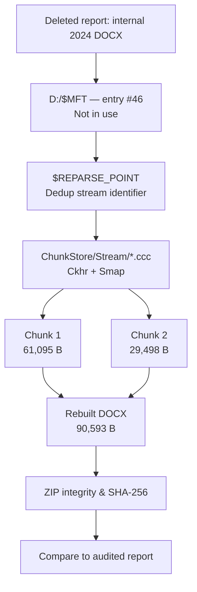

# Stonks — Recovering a Deleted Financial Report

**Hack The Box Sherlock · Windows DFIR · NTFS · Data Deduplication · AD1**

A real-estate corporation was suspected of inflating its financial performance. The acquired Windows Server volume held an audited 2024 financial statement and metadata for a deleted *internal* version. We recovered the internal DOCX by reconstructing the original data from **Windows Data Deduplication chunks**, then compared the two reports.


> **Result:** A deleted 90,593-byte DOCX was rebuilt from **two chunks**. Its 2024 `Profit for the year` is **−1,647,555**, whereas the audited version reports **+2,672,196**, both in `$'000`. The difference is **4,319,751** in the documents' reported units (equivalent to $4,319,751,000).

## Case summary

| Evidence | Finding |
|---|---|
| Image | `evidence.ad1` (logical AD1 acquisition, not a physical RAW image) |
| Target | NTFS partition 3, labeled `Data` / D: |
| Deleted document | `Internal Consolidated Financial Statements 2024.docx` |
| Comparison document | `Audited Consolidated Financial Statements 2024.docx` |
| MFT record | **46** — `Flags = 0x0000` (not in use) |
| $REPARSE_POINT | Attribute `0xC0` at absolute MFT offset `0x0000B9B0` |
| Dedup reparse tag | `0x80000013` |
| Chunk map | Dedup `Stream` container; `Smap` at `0x52C8` |
| Chunks | **61,095 + 29,498 = 90,593 bytes** |
| Recovered SHA-256 | `e51e773e5404f29cc2816cff3fbdcc8b2c28f9e8040a6e7fe926b21336b66513` |
| DOCX creator | **Elaine Chua — Senior Accountant** (document metadata) |
| Reported profit discrepancy | **4,319,751** (`$'000`) |

## Why Data Deduplication matters

Windows Server Data Deduplication processes eligible files after they are written, identifies repeated byte ranges, moves reusable chunks into a shared **ChunkStore**, and replaces an optimized file's ordinary content with a **reparse-point reference**. When a deduplicated file is deleted, its metadata and/or underlying chunks may survive until they are reused or collected.

That is exactly the opportunity in this case: the DOCX was no longer active in NTFS, yet both its mapping information and its content chunks survived in the acquired evidence.



See [Data Deduplication explained](./deduplication-explained.md) for a visual guide to the storage concepts.

## Investigation sequence

1. **Inspect the acquisition:** open the AD1 in FTK Imager or parse its directory and content index. Locate D:, `Finance`, `$MFT` and `System Volume Information\Dedup`.
2. **Review configuration and jobs:** examine `dedupConfig.01.xml`, `dedupStatistics.xml`, relevant EVTX logs and the Throughput Optimization scheduled task.
3. **Prove deletion:** read NTFS `$MFT` record 46. Its in-use flag is cleared; the evidence is stronger than a filename search.
4. **Follow the $REPARSE_POINT:** extract its dedup stream identifier and locate its record in the `Stream` container.
5. **Read the Smap:** identify the two chunk records in the `Data` container and their original logical order.
6. **Reconstruct and verify:** concatenate the payloads, check the DOCX ZIP archive, and compute SHA-256.
7. **Compare financial data:** examine the `Profit for the year` row in both 2024 consolidated profit-and-loss accounts.

## Reproduce the extraction

Requires Python 3 and the original `evidence.ad1`. No third-party Python packages.

```bash
python3 recover_stonks.py evidence.ad1 -o recovered_report.docx
sha256sum recovered_report.docx
```

Windows:

```powershell
py -3 .\recover_stonks.py .\evidence.ad1 -o recovered_report.docx
certutil -hashfile recovered_report.docx SHA256
```

Expected hash: `e51e773e5404f29cc2816cff3fbdcc8b2c28f9e8040a6e7fe926b21336b66513`. The script validates the size, hash and DOCX ZIP structure before writing the result.

**Scope:** This is a read-only, *case-specific* AD1/NTFS/Dedup parser, not a universal decoder.

## Documentation

| Section | Contents |
|---|---|
| [Deduplication explained](./deduplication-explained.md) | Why chunks, reparse points and deletion matter |
| [Forensic analysis](./forensic-analysis.md) | Artifacts, configuration, timeline and $MFT evidence |
| [Recovery walkthrough](./recovery-walkthrough.md) | Byte offsets, Ckhr/Smap, step-by-step extraction and validation |
| [Financial comparison](./financial-comparison.md) | Author metadata, profit discrepancy, accounting units and caveats |
| [Challenge findings](./findings.md) | All challenge questions with answers and evidence sources |
| [Recovery script](./recover_stonks.py) | Reproducible Python code |

## Interpretation and limitations

- **Deletion** is supported by `$MFT` record #46, but it does not identify the deleting user or intent.
- **Authorship** in `docProps/core.xml` identifies the recorded DOCX author, not legal responsibility.
- **Financial discrepancy** is demonstrated by comparing the supplied documents. Conclusions about intent or criminal liability require separate corroboration.
- **Preserve evidence:** no original AD1, private financial documents or recovered payloads are published here.

## Technical references

- [Microsoft Learn: Data Deduplication overview](https://learn.microsoft.com/en-us/windows-server/storage/data-deduplication/overview)
- [Microsoft Learn: Understanding Data Deduplication](https://learn.microsoft.com/en-us/windows-server/storage/data-deduplication/understand)
- [Microsoft: About Data Deduplication and garbage collection](https://learn.microsoft.com/en-us/previous-versions/windows/desktop/dedup/about-data-deduplication)

*Case-specific figures were derived from the supplied Sherlock evidence. Microsoft documentation is used only for background.*
