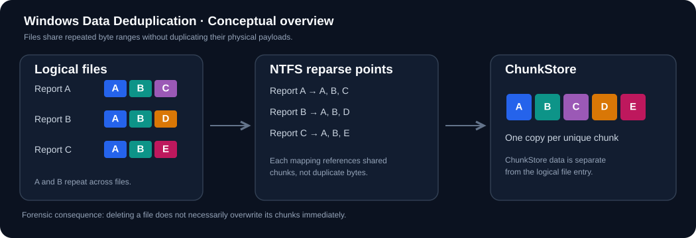

# Windows Data Deduplication — A Forensic Primer

**This guide provides the background needed to understand the [Stonks investigation](./README.md).** It is an explanation of Windows Server storage behavior, followed by the concrete evidence from this Sherlock.



## 1. What problem does it solve?

Consider a shared corporate server with hundreds of Word reports. Different reports often contain identical boilerplate, tables, images and templates. Storing all of those repeated byte sequences uses unnecessary disk space.

Windows Server **Data Deduplication** identifies repeated regions across eligible files on an enabled NTFS volume. Unique content is stored as *chunks*, optionally compressed, while individual files retain logical references to the chunks they need.

Important distinctions:

- Deduplication is **not** the same as deleting user files.
- It is generally a **post-processing** operation: the server writes a file normally, then optimization jobs consider eligible files later.
- A user opening a deduplicated file normally gets the same logical bytes as before optimization.
- Installing the Windows feature, **enabling it on a volume**, scheduling a job, and **actually optimizing files** are different events.

## 2. A simple model

Suppose three logical files contain these chunk sequences:

```text
Report 1: [A][B][C]
Report 2: [A][B][D]
Report 3: [A][B][E]

Instead of saving A three times and B three times:

ChunkStore: [A][B][C][D][E]     (5 unique chunks)
File maps:
  Report 1 -> A, B, C
  Report 2 -> A, B, D
  Report 3 -> A, B, E
```

This is deliberately simplified: real chunk boundaries are variable-size and depend on optimization policy and content.

## 3. Where do the pieces live?

| Windows / NTFS concept | Purpose | Why a forensic analyst cares |
|---|---|---|
| `$MFT` | NTFS records filenames, attributes and file metadata | A freed record may preserve the deleted filename and attributes |
| `$STANDARD_INFORMATION` | Contains file timestamps and FILE_ATTRIBUTE bits | Helps identify special file attributes |
| `FILE_ATTRIBUTE_SPARSE_FILE` (`0x0200`) | Marks a sparse-file attribute | May coexist with deduplication-related structures |
| `FILE_ATTRIBUTE_REPARSE_POINT` (`0x0400`) | Marks a reparse-point file | Strong clue to inspect `$REPARSE_POINT`, though not all reparse points are dedup |
| `$REPARSE_POINT` (`0xC0`) | Stores reparse tag and data | A Dedup tag and stream identifier can link to the chunk mapping |
| `Stream/*.ccc` | Contains metadata describing deduplicated file streams | In this image, a matching `Ckhr` leads to the `Smap` |
| `Data/*.ccc` | Contains the physical chunk records | May allow extraction of surviving original payloads |
| `dedupConfig.01.xml` | Volume Dedup options and exclusions | Reveals policy; not a complete history of past transitions |
| `dedupStatistics.xml` | Dedup volume statistics | Reports optimized file count and space savings |

The Dedup file-system filter (`Dedup.sys`) normally coordinates transparent reads. In a *forensic* logical acquisition, however, an export of a deleted/optimized file may contain only placeholder bytes; following the reparse mapping into ChunkStore can be necessary.

## 4. Why deleting the file may not destroy its content

A deleted optimized file loses its normal active directory entry. But its NTFS record can retain old metadata, and the ChunkStore may still hold its data. Windows also performs Dedup **garbage collection**, so an unreferenced chunk is **not guaranteed** to remain available indefinitely.

```mermaid
sequenceDiagram
    participant NTFS as NTFS/$MFT
    participant Dedup as Dedup ChunkStore
    participant Examiner as Forensic examiner
    Note over NTFS,Dedup: File has been optimized
    NTFS->>Dedup: Reparse mapping points to chunks
    Note over NTFS: File is deleted; record marked unused
    Note over Dedup: Chunks may remain until garbage collection
    Examiner->>NTFS: Recover record + reparse metadata
    Examiner->>Dedup: Resolve stream map + chunk locations
    Dedup-->>Examiner: Remaining chunk payloads
    Examiner->>Examiner: Reconstruct logical file + hash
```

## 5. What Stonks demonstrates

On volume D:, the deleted report has these exact NTFS `FILE_ATTRIBUTE` flags in its `$STANDARD_INFORMATION` attribute:

| Attribute | Value |
|---|---|
| `FILE_ATTRIBUTE_ARCHIVE` | `0x0020` |
| `FILE_ATTRIBUTE_SPARSE_FILE` | `0x0200` |
| `FILE_ATTRIBUTE_REPARSE_POINT` | `0x0400` |
| **Combined** | **`0x0620`** |

**Do not confuse** these FILE_ATTRIBUTE flags with the **MFT record header** flags: the latter were `0x0000`, which means this file record was **not in use**.

The report's reparse tag is `0x80000013` (Windows Dedup). Its stream mapping contained **two** chunk entries of **61,095** and **29,498** bytes, allowing an exact **90,593-byte** DOCX reconstruction.

## 6. Common DFIR mistakes to avoid

1. Assuming `FILE_ATTRIBUTE_REPARSE_POINT` alone identifies Data Deduplication. **Read the actual tag**.
2. Treating a filename found inside AD1 as proof of deletion. **Check NTFS record state**.
3. Assuming installation time equals volume enablement time. **Separate service/package install, policy changes and completed optimization jobs**.
4. Treating `dedupStatistics.xml`'s current `savingsSize` as the bytes saved by the *first* optimization job. **Those answer different questions**.
5. Hashing a placeholder or zero-filled export and calling it the recovered report. **Validate content and ZIP structure first**.
6. Inferring malice or responsibility solely from document creator metadata. **Separate file provenance from actor attribution**.

## 7. Further reading

- [Microsoft Learn — Overview](https://learn.microsoft.com/en-us/windows-server/storage/data-deduplication/overview)
- [Microsoft Learn — How Deduplication works and job types](https://learn.microsoft.com/en-us/windows-server/storage/data-deduplication/understand)
- [Microsoft — ChunkStore and garbage collection](https://learn.microsoft.com/en-us/previous-versions/windows/desktop/dedup/about-data-deduplication)

Return to [Stonks](./README.md) or follow the [step-by-step recovery](./recovery-walkthrough.md).
