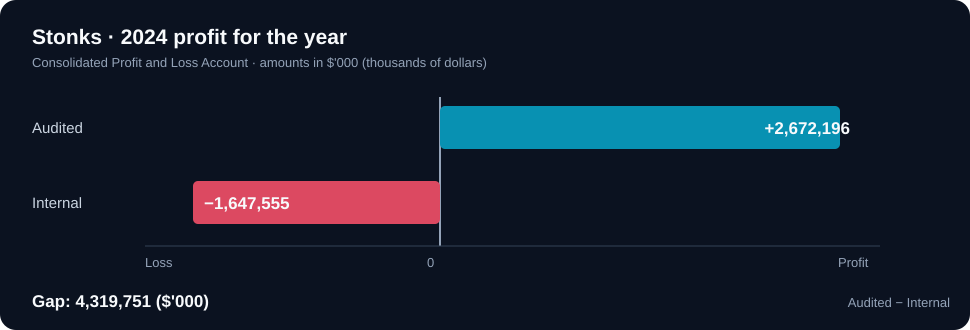

# Stonks — Financial Statement Comparison

The technical recovery establishes that the deleted DOCX survived in the deduplicated ChunkStore. This section addresses the **meaning** of the recovered report and the discrepancy with the audited financial statements.

## Documents compared

| Report | Status in the acquisition | Evidence |
|---|---|---|
| `Internal Consolidated Financial Statements 2024.docx` | Deleted file, reconstructed from two Dedup chunks | MFT #46, reparse point, Stream/ChunkStore and verified DOCX |
| `Audited Consolidated Financial Statements 2024.docx` | Separate report present in the acquired finance folder | AD1 file entry and DOCX contents |

The reports concern **Aurora Land Development Limited** and its subsidiaries (name appearing in the supplied report text).

## Document properties and attribution

A `.docx` file is a ZIP container of XML parts. Creator/last-editor data are normally in `docProps/core.xml`.

From the recovered internal report:

```xml
<dc:creator>Elaine Chua - Senior Accountant</dc:creator>
<cp:lastModifiedBy>Elaine Chua - Senior Accountant</cp:lastModifiedBy>
<dcterms:created xsi:type="dcterms:W3CDTF">2025-09-16T15:59:00Z</dcterms:created>
<dcterms:modified xsi:type="dcterms:W3CDTF">2025-09-16T16:02:00Z</dcterms:modified>
```

**Recorded document author: Elaine Chua.** This is a DOCX metadata value, not direct evidence that she falsified the reports or deleted the file. Such metadata can also be modified.

### Reproduce metadata inspection with Python

```python
import zipfile
from xml.etree import ElementTree as ET

path = "recovered_report.docx"
with zipfile.ZipFile(path) as z:
    root = ET.fromstring(z.read("docProps/core.xml"))

dc = "{http://purl.org/dc/elements/1.1/}"
cp = "{http://schemas.openxmlformats.org/package/2006/metadata/core-properties}"
print("Creator:", root.findtext(dc + "creator"))
print("Last modified by:", root.findtext(cp + "lastModifiedBy"))
```

To inspect document text without Microsoft Word, read `word/document.xml` from the same ZIP, preserving the table row/cell structure rather than relying on a simple text search.



## Consolidated Profit and Loss Account — financial year 2024

The row `Profit for the year` appears in both documents, in the **2024** column of the consolidated profit-and-loss table. The column header is **`2024 $'000`**: values are shown in **thousands of dollars**.

| 2024 line item | Audited report (`$'000`) | Internal report (`$'000`) |
|---|---:|---:|
| Revenue | 10,082,467 | 6,083,427 |
| Operating profit | 1,897,307 | −1,269,933 |
| Profit before taxation | 3,312,702 | −1,432,882 |
| **Profit for the year** | **+2,672,196** | **−1,647,555** |

### Exact answer to the task

```text
Audited profit:    +2,672,196
Internal profit:   -1,647,555
Difference:         4,319,751   ($'000)
```

Or mathematically:

```text
2,672,196 - (-1,647,555) = 4,319,751
```

**Challenge answer: `4319751`.** Multiplying by 1,000 gives the equivalent amount in individual dollars (`4,319,751,000`), **but that multiplied number is not the challenge's expected format**.

Revenue also differs by `10,082,467 − 6,083,427 = 3,999,040` in `$'000`. It supports a broader discrepancy between the supplied versions, though this Sherlock's question asks specifically about annual profit.

## Accounting and forensic cautions

- The internal document contains other figures that do not consistently reconcile with its revised profit values. This strengthens the need for independent accounting review rather than treating any single document as complete proof of financial misconduct.
- `dc:creator` and `cp:lastModifiedBy` are editable file properties, not digital signatures or attribution of a crime.
- The filesystem evidence proves deletion, but no provided artifact here establishes **who performed the deletion**.
- The comparison establishes a substantial difference in two versions of the financial statements. Proving intent, approval chains or legal responsibility requires further records and investigation.

Return to [case overview](./README.md), [forensic analysis](./forensic-analysis.md), or [recovery walkthrough](./recovery-walkthrough.md).
