# Stonks — Reconstructing the DOCX from Data Deduplication

This page is the **reproducible recovery walkthrough**. It explains *where the bytes came from* and why the recovered output is the original document, not a zero-filled placeholder.

**Source:** `evidence.ad1`, logical AD1 acquisition, Partition 3 (Data / D:).  
**Target:** `Internal Consolidated Financial Statements 2024.docx`  
**Final size:** **90,593 bytes**  
**SHA-256:** `e51e773e5404f29cc2816cff3fbdcc8b2c28f9e8040a6e7fe926b21336b66513`

## 1. Why simply exporting the deleted file fails

Exporting the deleted report's logical AD1 entry yielded a 90,593-byte **zero-filled** file rather than a working DOCX. The source evidence still contained the filename and logical size, but the content required resolving its Data Deduplication reparse point and ChunkStore references.

This is an important forensic trap: a file can have the expected name and length and still be **invalid evidence content**. Never accept a hash until the reconstructed data is validated.

## 2. Extraction path

```mermaid
flowchart LR
    A["evidence.ad1"] --> B["D:/$MFT"]
    B --> C["Record #46"]
    C --> D["$REPARSE_POINT"]
    D --> E["Dedup stream ID"]
    E --> F["Stream/00010000.00000001.ccc"]
    F --> G["Smap: 2 entries"]
    G --> H["Data/00000001.00000001.ccc"]
    H --> I["Two chunk payloads"]
    I --> J["Recovered DOCX"]
```



The case-specific Python script first walks the AD1 index, reads each selected file's compressed blocks, and decompresses them with Python's `zlib` module. It extracts:

```text
D:\$MFT
D:\System Volume Information\Dedup\ChunkStore\
  {6F89FF76-AE45-4802-BD0E-4075177C075F}.ddp\
    Stream\00010000.00000001.ccc
    Data\00000001.00000001.ccc
```

**AD1 is a logical evidence container:** this is an extraction of files included in the acquisition, not a raw sector scan.

## 3. Prove that the DOCX was deleted

```text
MFT slot number             46
Bytes per record            1024
Absolute record start       46 * 1024 = 0xB800
Signature                   FILE
Record header Flags         0x0000  (InUse bit clear)
```

The record's `$STANDARD_INFORMATION` FileAttributes are `0x0620` (Archive + Sparse File + Reparse Point), distinct from the deletion-related record header flags.

The `$REPARSE_POINT` (NTFS attribute type `0xC0`) begins at relative offset `0x1B0`:

```text
0xB800 + 0x1B0 = 0x0000B9B0
```

Its reparse tag is `0x80000013`, which identifies a Windows Deduplication reparse point.

## 4. Match the stream metadata

The resident reparse data contains a 32-byte stream identifier. In **this image**, the parser finds it at bytes `96:128` of the extracted resident value:

```text
f0973cbb3c2b95864ee8409f58687917
c2b1865e0175731e6895f7808c867d19
```

Searching the `Stream/*.ccc` content for that identifier locates the corresponding `Ckhr` record and its `Smap` structure.

**Smap starts at Stream offset `0x52C8`.** It contains **two** 64-byte chunk-map entries, each providing the chunk identifier, container references, record location, cumulative logical end offset and data size.

## 5. Resolve the two chunks in the Data container

In this specific image, each referenced `Data/*.ccc` record begins with an **88-byte `Ckhr` header** followed by an **uncompressed payload**.

| Order | Chunk number | Ckhr header offset | Payload offset | Payload length |
|---|---:|---|---|---:|
| 1 | 7 | `0x6CE20` | `0x6CE78` | **61,095** |
| 2 | 8 | `0x7BD20` | `0x7BD78` | **29,498** |
| **Total** | | | | **90,593** |

The bytes are reconstructed in the map's logical order:

```python
first = data[0x6CE78 : 0x6CE78 + 61095]
second = data[0x7BD78 : 0x7BD78 + 29498]
recovered = first + second
assert len(recovered) == 90593
```

Here, the `Smap` entries' cumulative ends are **61,095** and **90,593**. They confirm that this ordering covers the full logical file.

**This is not a general Windows Dedup decoder:** different Windows versions and ChunkStore formats can use different mapping structures, compression and references. Do not assume these hard-coded offsets are valid for arbitrary evidence.

## 6. Test it yourself

Download the [recovery script](./recover_stonks.py), place it beside `evidence.ad1` and run:

```bash
python3 recover_stonks.py evidence.ad1 -o recovered_report.docx
```

Expected meaningful output:

```text
[+] MFT #46 Flags=0x0000 (not in use)
[+] $REPARSE_POINT at 0x0000b9b0
[+] Smap 0x52c8: 2 chunks
[+] Chunk 1: ID=7, header=0x6ce20, payload=0x6ce78, length=61,095
[+] Chunk 2: ID=8, header=0x7bd20, payload=0x7bd78, length=29,498
[+] Recovered 90,593 bytes
[+] SHA-256 e51e773e5404f29cc2816cff3fbdcc8b2c28f9e8040a6e7fe926b21336b66513
[+] DOCX ZIP integrity OK (29 entries)
```

You can independently verify the hash:

```bash
sha256sum recovered_report.docx
```

Or in Windows:

```powershell
certutil -hashfile recovered_report.docx SHA256
```

## 7. Why the recovery is credible

Three checks reinforce each other:

1. **Logical length**: chunk lengths add up to the recorded 90,593-byte file size.
2. **File format**: the reconstructed bytes form a valid DOCX (ZIP-based Office Open XML), containing **29 internal ZIP entries** with no ZIP integrity errors.
3. **Cryptographic integrity**: repeated executions on the provided AD1 produce the same SHA-256, `e51e773e5404f29cc2816cff3fbdcc8b2c28f9e8040a6e7fe926b21336b66513`.

The recovered document includes `docProps/core.xml` and `word/document.xml`. The former contains document metadata; the latter allows the profit-and-loss data to be compared with the audited version.

Proceed to [financial comparison](./financial-comparison.md).

## Forensic cautions

- The script reads the AD1 **read-only** and writes only the resulting output file.
- Treat AD1, recovered documents and logs as forensic evidence; preserve their original copies and provenance.
- A valid reconstruction does not establish the deleting actor, financial fraud intent or legal liability.
- The repo deliberately does **not** redistribute original/recovered financial documents.
